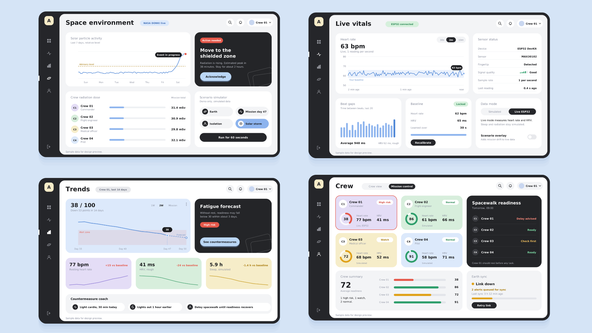

 

 ASTRA – Astronaut Health Monitoring System

ASTRA is a space-focused health monitoring dashboard designed to help monitor astronaut health and well-being during space missions.

The platform aims to provide real-time health insights, track vital signs, visualize health trends, and monitor the space environment through a centralized dashboard.

🎯 Project Objective

To develop a health monitoring platform that can collect, visualize, and analyze astronaut health data, helping identify potential health risks and support better decision-making during space missions.

✨ Key Features

Overview Dashboard – Centralized view of astronaut health information.

Live Vitals – Monitor vital signs such as heart rate, SpO₂, and body temperature.

Health Trends – Visualize historical health data and identify patterns.

Space Environment – Monitor environmental conditions during space missions.

Crew Management – View and manage astronaut profiles and health information.